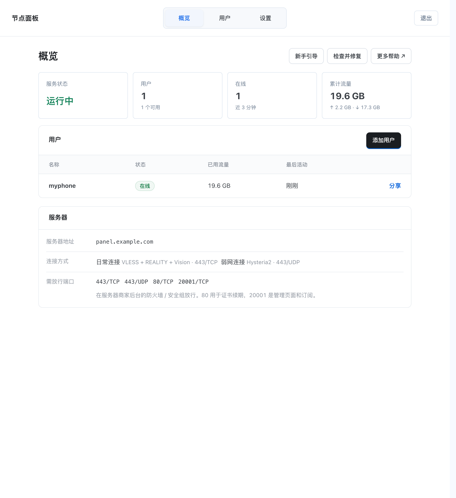
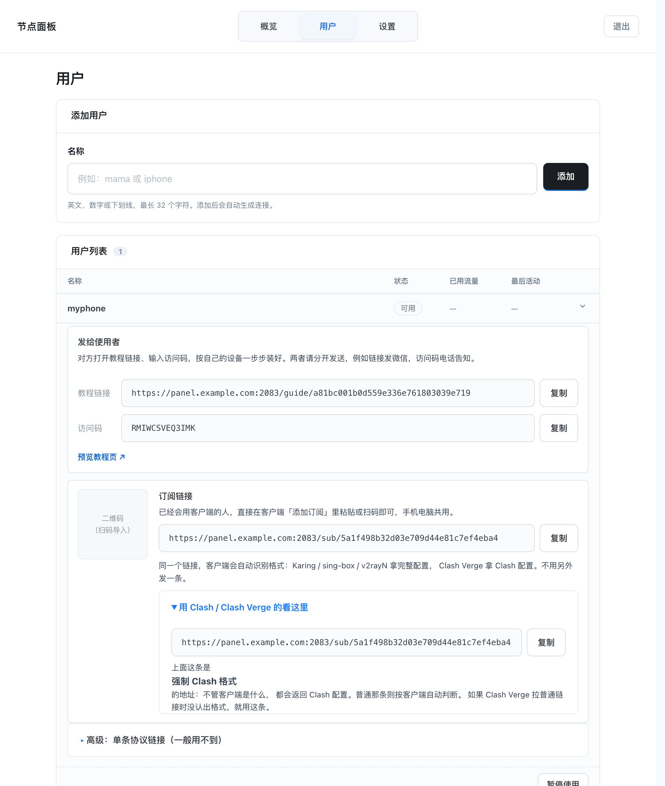
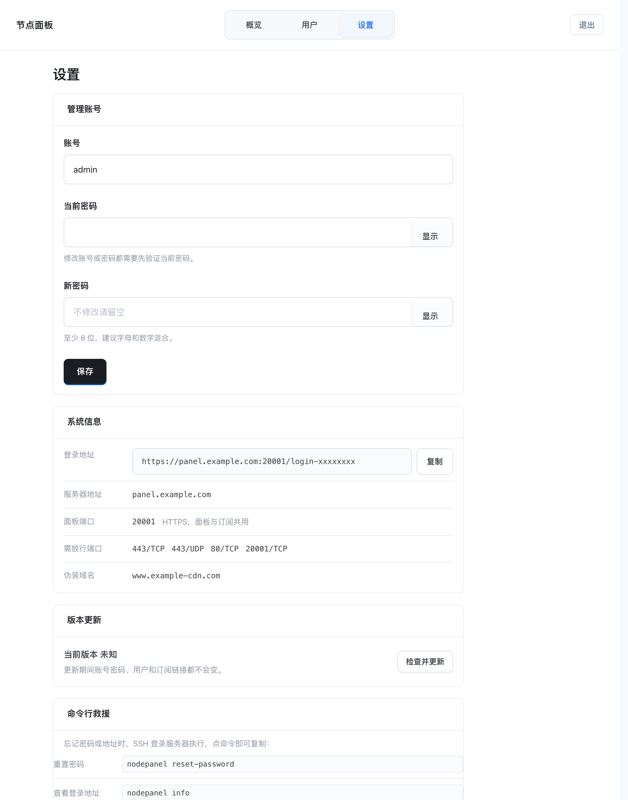

<div align="center">

# NodePanel

**自建 VPN 面板 —— 一条命令装好，网页上点几下就能用**

给家人朋友分连接，不需要懂 Linux

[](LICENSE)


[快速开始](#快速开始) · [安装指南](INSTALL.md) · [常见问题](INSTALL.md#常见问题) · [扩展功能](#扩展功能)

</div>

---



---

## 这是什么

把你自己的服务器变成一台专属 VPN。装好之后你会得到一个网页，在上面：

- **添加用户** —— 起个名字，系统自动生成连接
- **发给家人** —— 一条教程链接 + 一个访问码，对方照着页面就能装好
- **看用量** —— 谁在线、用了多少流量、上次什么时候连的

你只需要一台服务器。其他都是自动的。

## 为什么用它

| | 现成的机场 | 手动搭建 | **NodePanel** |
| :--- | :---: | :---: | :---: |
| 服务器属于谁 | 机场主 | 你自己 | **你自己** |
| 需要懂技术吗 | 不需要 | 要会 Linux | **不需要** |
| 流量经过谁 | 机场主 | 只有你 | **只有你** |
| 跑路 / 被封风险 | 有 | 没有 | **没有** |
| 给家人用 | 各自买 | 逐个配 | **网页上点几下** |
| 费用 | 按月付费 | 只付服务器 | **只付服务器** |

## 快速开始

在一台 **Debian 12 / Ubuntu 22.04** 的服务器上，用 root 执行：

```bash
bash <(curl -fsSL https://raw.githubusercontent.com/2337312664/nodepanel/main/install.sh)
```

会问你几个问题（服务器是什么类型、端口怎么填），然后自动装好。
**大约 5 分钟**，结束时给出面板地址和密码。

<details>
<summary><b>不想用向导？直接安装</b></summary>

```bash
bash <(curl -fsSL https://raw.githubusercontent.com/2337312664/nodepanel/main/install-webui.sh)
```

端口受限（NAT）的服务器需要多指定几个端口，见 [安装指南](INSTALL.md)。
</details>

> **完全不懂 Linux？** 看 [安装指南](INSTALL.md) —— 从怎么连服务器开始讲。

## 功能

<table>
<tr>
<td width="50%" valign="top">

**管理**

- 用户增删、暂停、恢复
- 一键重置某个人的连接
- 教程链接 + 访问码分离发送
- 流量统计与在线状态

</td>
<td width="50%" valign="top">

**连接**

- VLESS + REALITY（主力，最难被识别）
- Hysteria2（弱网 / 丢包时用）
- AnyTLS、TUIC（兼容备用）
- 智能订阅：一条链接适配所有客户端

</td>
</tr>
<tr>
<td valign="top">

**维护**

- 面板内一键检查并修复
- 面板内一键更新（带签名校验）
- 命令行救援（忘记密码等）
- 备份与恢复

</td>
<td valign="top">

**部署**

- 自动申请 HTTPS 证书
- 自动配置防火墙
- 自动开启 BBR 加速
- 支持公网 IP / NAT / 容器

</td>
</tr>
</table>

## 界面

<table>
<tr>
<td width="50%"></td>
<td width="50%"></td>
</tr>
<tr>
<td align="center"><b>用户管理</b><br>每人独立的教程链接与订阅</td>
<td align="center"><b>设置</b><br>协议、证书、端口一目了然</td>
</tr>
</table>

## 客户端支持

| 平台 | 推荐 | 说明 |
| :--- | :--- | :--- |
| iPhone / iPad | Karing、sing-box MT | 面板里有下载按钮 |
| Android | Karing、v2rayNG | |
| Windows | sing-box、v2rayN | |
| macOS | sing-box、v2rayN | |
| Clash Verge | 也支持 | 面板会返回 Clash 配置 |

**同一条订阅链接通用** —— 客户端自己识别格式，不用分别发。

## 常用命令

装完后 SSH 到服务器可以执行：

| 命令 | 作用 |
| :--- | :--- |
| `nodepanel info` | 查看访问地址、账号、要放行的端口 |
| `nodepanel reset-password` | 重置管理密码 |
| `nodepanel reset-path` | 换一个登录地址 |
| `nodepanel repair` | 连不上时重建配置并重启 |
| `nodepanel backup` | 备份全部用户和设置 |

完整列表见 [安装指南](INSTALL.md#常用命令)。

## 扩展功能

<details>
<summary><b>住宅代理落地</b> —— 让网站看到的 IP 是住宅代理</summary>

出网流量交给上游 SOCKS5 / HTTP 代理，**用户的连接方式和订阅链接都不变**。

面板「设置 → 高级设置 → 住宅代理落地」，或命令行：

```bash
nodepanel relay socks5 proxy.example.com 1080 --username U --password P
nodepanel relay --off      # 关闭，恢复直连
```
</details>

<details>
<summary><b>中转落地</b> —— 本机作为入口机，把流量推给另一台落地机</summary>

适合「入口机线路好但会被封，落地机干净」的场景。两台都装本面板：

1. **落地机**上点「我是落地机，导出接入参数」，拿到参数
2. **入口机**上填进「中转落地」

```bash
nodepanel uplink vless-reality <落地机IP> 443 --uuid U --sni S --public-key K --short-id I
nodepanel uplink --off
```

两个功能可**叠加**：`用户 → 入口机 → 落地机 → 住宅代理 → 目标`
</details>

## 安全设计

- 面板以**非特权用户**运行；特权操作经过一个只接受白名单命令的 root helper
- 代理内核**独立低权限**运行，配置只读挂载
- 密码 bcrypt 哈希，登录失败限流并临时锁定
- 更新走 **Ed25519 签名 + 逐文件 SHA-256** 双重校验，失败自动回滚
- 未登录访问任何受保护路径统一返回 404

## 环境要求

| 项目 | 要求 |
| :--- | :--- |
| 系统 | Debian 12+ / Ubuntu 22.04+（需 systemd） |
| 架构 | x86_64 或 ARM64 |
| 内存 | 1GB 建议；512MB 可用 |
| 网络 | 公网 IPv4；端口受限环境见 [安装指南](INSTALL.md) |

## 遇到问题

1. **面板打不开** —— 多半是端口没在商家后台放行（[排查](INSTALL.md#面板打不开)）
2. **客户端连不上** —— 检查协议端口是否放行；或在首页点「检查并修复」
3. **忘记密码** —— SSH 执行 `nodepanel reset-password`

更多见 [安装指南的常见问题](INSTALL.md#常见问题)。

## 许可

基于 [iwantruncom/renrenVPN](https://github.com/iwantruncom/renrenVPN)（GPL-3.0）修改而来，
以 **GPL-3.0** 分发。第三方依赖与致谢见 [NOTICE.md](NOTICE.md)。

自用不受限制；对外分发时须保留许可声明并提供完整源码。

---

<div align="center">
<sub>如果你觉得有用，欢迎点个 Star ⭐</sub>
</div>
